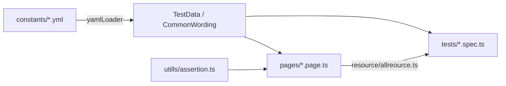

# develop
demo my coding: โปรเจกต์ฝึกเขียน Test Automation ด้วย Playwright + TypeScript (เว็บตัวอย่าง [saucedemo](https://www.saucedemo.com/) และ API ตัวอย่าง PokéAPI)

## 📁 โครงสร้างโปรเจกต์

```
develop/
├── .github/workflows/playwright.yml   # CI บน GitHub Actions
├── constants/                         # ข้อมูลที่ใช้ในเทส (YAML)
│   ├── testdata.yml                   # URL, user/password, ชื่อสินค้า, ข้อมูลผู้ซื้อ
│   └── commonwording.yml              # ข้อความบนหน้าจอที่ใช้ตรวจ (title, error, success)
├── pages/                             # Page Object: action + locator ของแต่ละหน้า
│   ├── common.page.ts                 # action กลาง: goto, clearAndFill, clickElement, getNumericString
│   ├── loginPages.page.ts             # หน้า Login
│   ├── inventoryPages.page.ts         # หน้ารายการสินค้า: เพิ่มลงตะกร้า, ไปหน้าตะกร้า
│   ├── cart.page.ts                   # หน้าตะกร้า: ชื่อ/จำนวน/ราคา, ลบสินค้า
│   └── checkout.page.ts               # หน้า Checkout ทั้ง 3 step: กรอกข้อมูล, overview, complete
├── resource/allreource.ts             # จุด export รวม ให้เทส import จากที่เดียว
├── utills/
│   ├── assertion.ts                   # assertion กลาง: checkUrl, hasText, isVisibled, loginError
│   └── yamlLoader.ts                  # โหลด YAML เป็น TestData และ CommonWording
├── tests/
│   ├── saucedemo/                     # UI test ของ saucedemo (login, shopping cart + checkout)
│   └── other/                         # API test (PokéAPI) และตัวอย่างอื่น ๆ
├── playwright.config.ts               # ตั้งค่า Playwright (browser, reporter, video)
└── tsconfig.json                      # module esnext + moduleResolution bundler
```

## 🔄 Flow การทำงาน: Data → Page Object → Test



1. **Data**: ข้อมูลและข้อความทั้งหมดเก็บใน `constants/*.yml` ถ้าข้อมูลเปลี่ยน แก้ที่ YAML ที่เดียว
2. **yamlLoader**: โหลด YAML เป็น object `TestData` และ `CommonWording`
3. **Page Object**: แต่ละไฟล์ใน `pages/` เก็บ locator และ action ของหน้านั้น โดยใช้ `commonPage` และ `assertion` เป็นตัวช่วย
4. **Test**: spec ใน `tests/` import ทุกอย่างผ่าน `resource/allreource.ts` แล้วเรียก action ต่อกันเป็น flow โดยแบ่งแต่ละช่วงด้วย `test.step`

ตัวอย่าง flow สั่งซื้อ (`ui-saucedemo-shoppingcart.spec.ts`):
Login → เพิ่มเป้และแจ็กเก็ต → ไปตะกร้า → ลบแจ็กเก็ต → Checkout กรอกข้อมูล → Overview ตรวจสินค้า ราคา และยอดรวม → Finish → หน้าสำเร็จ → กลับหน้าแรก

## ⚙️ CI บน GitHub
`.github/workflows/playwright.yml` รันเทสอัตโนมัติเมื่อ push หรือเปิด PR เข้า `main` หรือ `master` แล้วอัปโหลด `playwright-report` เป็น artifact เก็บไว้ 30 วัน
หมายเหตุ: push เข้า feature branch เช่น `feature/pokemon-api` จะยังไม่ trigger CI จนกว่าจะเปิด PR เข้า `main`

## 🌿 Branch
- `main`: โค้ดหลัก
- `feature/pokemon-api`: branch ที่กำลังพัฒนา มี API test ของ PokéAPI, UI test ของ saucedemo (login, shopping cart, checkout) และโครงสร้าง Page Object + YAML

## 🚀 เริ่มใช้งาน
```bash
npm ci
npx playwright install
```

### 💡 คำสั่งการรัน Test
1. รัน UI Mode : `npm run test:ui`
2. รัน Report Generator (เปิดหน้าจอ + เปิดรายงาน) : `npm run test:report`
3. รัน No UI : `npm run test:noui`
4. รัน กรณีมี Failure : `npm run test:lastfail`
5. รัน Debug Mode : `npm run test:debug`
